    

---

## 🌿 About Me

  

## 🛠️ Tech Stack

  

---

## 📊 GitHub Stats

<h3>⚡ Overview</h3>

<h3>🔥 Streak</h3>

<h3>📈 Activity</h3>

<h3>🏆 Trophies</h3>

---

## 🤝 Connect With Me

  

&nbsp;&nbsp;&nbsp;
&nbsp;&nbsp;&nbsp;
&nbsp;&nbsp;&nbsp;

  

---

  

